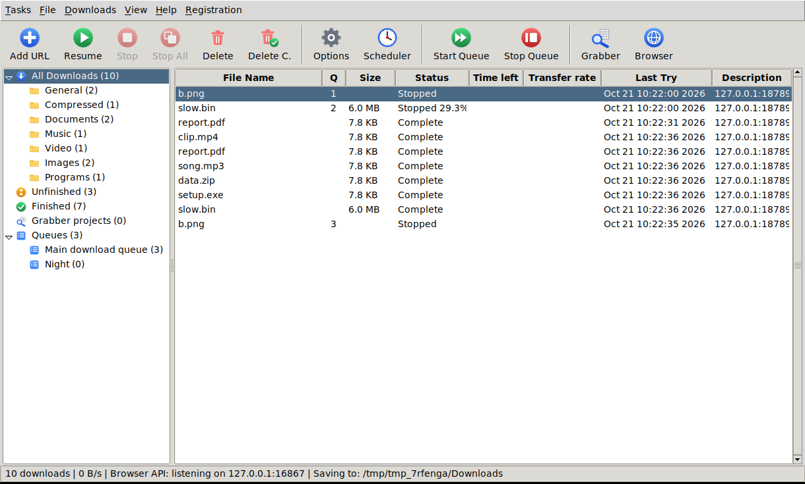

# OpenDM



A free, open-source download manager for Windows, macOS and Linux, inspired by tools like IDM.
One Python file, no dependencies for the basics.

- **Faster downloads:** splits files across up to 32 connections, and when one connection finishes early it takes over half of the slowest remaining piece (dynamic segmentation).
- **Pause and resume:** survives restarts. Failed connections retry automatically.
- **Queue, speed limit, scheduler:** global and per-download speed limits you can change mid-download; run only between chosen hours (overnight windows work); optionally exit or shut down when finished.
- **Categories and auto-sorting:** downloads are sorted into `Video`, `Documents`, `Music`, `Compressed`, `Images`, `Programs` and `General` folders by file type (or by website), using the file's real name even when the server only reveals it after the download starts. A sidebar filters the list by category, *Unfinished* and *Finished*, with live counts. Add, rename and edit categories, or move a download with right-click > *Move to category*.
- **System tray:** an icon with a quick menu (show, pause/resume all, speed limit, open folder, quit), a tooltip with the live status, balloon notifications when a download finishes or fails, and *close to tray* so downloads carry on in the background.
- **A classic download-manager window:** menu bar (Tasks, File, Downloads, View, Help, Registration), an icon toolbar, a navigation tree (All Downloads with its categories, Unfinished, Finished, Grabber projects, Queues) and a sortable list with File Name, Q, Size, Status, Time left, Transfer rate, Last Try and Description columns.
- **Queues and a site grabber:** keep downloads in named queues you can start and stop together, and scan any web page for the images, videos, documents or archives it links to.
- **Live speed graph:** a 60-second speed chart (all downloads, or just the one you select) with Now / Peak / Avg, plus a segment map showing which parts of the file each connection has filled.
- **Video downloads:** HLS (`.m3u8`) streams with quality selection, AES-128 decryption and ffmpeg muxing to `.mp4`; DASH (`.mpd`) manifests through ffmpeg; and YouTube, Facebook, Instagram, Vimeo, TikTok and similar sites through yt-dlp.
- **Browser integration:** a Chrome/Edge/Brave/Firefox extension that takes over downloads, adds a right-click menu, and adds an IDM-style **Download this video** button with a quality picker on playing videos.
- **GUI and CLI.**

OpenDM is an independent project. It is clean-room code written from public specifications (HTTP/1.1 Range requests, HLS). It contains no code from, and is not affiliated with, any commercial download manager.

## Install

**Option A: download a build** from the [Releases](https://github.com/alter-xsource404/OpenDM-final-release/releases/latest) page (Windows `.exe`, macOS `.app`, Linux binary).

**Option B: run from source** (Python 3.9+, tkinter included with most Python installs):

```
python opendm.py                 # GUI
pip install cryptography         # optional: only for AES-encrypted HLS streams
```

On Debian/Ubuntu you may need `sudo apt install python3-tk`. Install [ffmpeg](https://ffmpeg.org) if you want videos merged into `.mp4`.

## Usage

```
python opendm.py                                  # open the GUI
python opendm.py URL [URL ...] -n 8 -o ~/Downloads   # CLI: 8 connections
python opendm.py STREAM.m3u8 -q 720 -l 500        # video, max 720p, limit 500 KB/s
python opendm.py -p 6801                          # GUI, browser API on another port
```

Other options: `--sort` (CLI only: sort into category sub-folders of `-o`), `--minimized` (start in the tray), `--version`.

### The window

| Part | What it does |
|---|---|
| **Menu bar** | *Tasks*: add a download, add all links from the clipboard, run the site grabber, export/import the list, exit. *File*: open, open folder, move/rename, redownload, properties, copy address. *Downloads*: resume, stop, delete, move to a category or queue, start/stop queue, speed limiter, scheduler, categories, options. *View*: show or hide the toolbar, categories pane, speed graph and status bar; sort. *Help*, and *Registration* (OpenDM is free, so this just says so and shows the MIT license). |
| **Toolbar** | Add URL, Resume, Stop, Stop All, Delete, Delete C. (completed), Options, Scheduler, Start Queue, Stop Queue, Grabber and Browser (extension pairing). Buttons grey out when they don't apply. |
| **Navigation tree** | *All Downloads* with a folder per category, *Unfinished*, *Finished*, *Grabber projects* (one entry per project) and *Queues*. Counts are live. Right-click a queue to start, stop, rename or delete it. Drag the divider to resize. |
| **List** | **File Name**, **Q** (place in its queue), **Size**, **Status** (`Complete`, `45.30%`, `Stopped 12.0%`, `Queued`...), **Time left** (`2 min 15 sec`), **Transfer rate** (`1.5 MBytes/sec`), **Last Try** (`Oct 21 11:03:12 2026`), **Description** (the source site; edit it in Properties). Click a title to sort. |

Add downloads with **Add URL** (`Ctrl+N`): paste links, optionally pick a category and queue, then **Start Download** or **Download Later** (it waits in its queue until you start it). Double-click a finished file to open it; right-click for Open, Resume, Stop, Delete, Move to category/queue, Limit speed, Redownload, Properties and Copy address.

**Queues.** Every download belongs to a queue (`Main download queue` by default; create more with *Downloads > New queue*). *Start Queue* / *Stop Queue* act on the queue selected in the tree. Queues organise and start/stop work; the number of simultaneous downloads and the scheduler window apply to everything.

**Site grabber** (*Tasks > Run site grabber*). Enter a page address, choose what to look for (images, video, documents, archives...) and whether to follow that site's links one level, press *Explore*, tick the files you want and download them. They are grouped as a *Grabber project* in the tree. It reads normal HTML pages; pages that build their links with JavaScript show nothing.

**Keyboard:** `Ctrl+N` add, `Ctrl+R` resume, `Ctrl+S` stop, `Del` delete, `Enter` open, `Alt+Enter` properties, `F2` rename, `F5` refresh, `Ctrl+A` select all, `Ctrl+C` copy address.

### Categories

Open *Downloads > Categories* (or right-click a category in the tree) to edit them. Each category has a name, file types (`mp4, mkv`), an optional save folder (empty means `<download folder>/<name>`; relative folders are relative to the download folder) and optional websites (`school.example`: everything from that site goes here, even `.mp4` files). Rules are checked top to bottom, websites before file types, and **General** catches everything else. Turn auto-sorting off with the checkbox to keep everything in one folder (the category is still shown and filterable).

Right-click a download > **Move to category** to override it: before it starts that changes where it will be saved; once it has finished the file is moved. A half-downloaded file can't be moved. Deleting or renaming a category updates the downloads that used it.

### System tray

Needs the optional add-on: `pip install pystray pillow` (included in the Windows and Linux builds). Turn it on or off in *Downloads > Options*.

- Menu: Show OpenDM (also double-click), Pause all, Resume all, Speed limit (No limit / 256 KB/s / 512 KB/s / 1 MB/s / 5 MB/s), Open download folder, Quit.
- The window's close button hides OpenDM to the tray instead of quitting (switch off in Options). Use *Quit OpenDM* in the tray menu to exit.
- Balloon notifications appear when a download finishes or fails while the window is hidden or not in front.
- Not available on macOS (the library needs the thread the window uses). On GNOME, install the *AppIndicator* extension to see tray icons. If the tray can't start, OpenDM keeps working and Options says why.

## Browser extension

**Automatic setup.** Every time OpenDM starts it registers itself with your browsers ("native messaging"), so the extension needs no port, no token and no configuration:

1. Run OpenDM once. The **Browser** toolbar button shows what got registered (and lets you repair or remove it).
2. **Chrome / Edge / Brave / Chromium:** open `chrome://extensions` (or `edge://extensions`), enable *Developer mode*, *Load unpacked*, choose the `extension/` folder.
   **Firefox:** in `extension/`, replace `manifest.json` with `manifest.firefox.json`, then `about:debugging` → *This Firefox* → *Load Temporary Add-on*. (The extension id `opendm@alter-xsource404.github.io` must match in that manifest and in `FIREFOX_EXTENSION_ID` in `opendm.py`.)
3. Open the extension's options page: it should say *Connected to OpenDM through the browser integration*.

That is all. If OpenDM isn't running when you click a download, the extension starts it (minimized to the tray) and hands the download over. Turn that off in **Browser** if you prefer to start OpenDM yourself.

**How it works.** The browser looks up a *native messaging host* named `org.opendm.nativehost`:

| Where | What OpenDM writes |
|---|---|
| **Windows** (current user only, no admin rights) | A manifest under `%USERPROFILE%\.opendm\native\` and a registry value pointing at it: `HKCU\Software\Google\Chrome\NativeMessagingHosts\org.opendm.nativehost` and `HKCU\Software\Microsoft\Edge\NativeMessagingHosts\org.opendm.nativehost`. Brave, Chromium and Firefox get the same under their own vendor keys (`BraveSoftware\Brave-Browser`, `Chromium`, `Mozilla`), but only if that browser's key already exists. Chrome and Edge are always registered. |
| **Linux / macOS** | The manifest file in each installed browser's `NativeMessagingHosts` folder (for example `~/.config/google-chrome/NativeMessagingHosts/`). |

When the extension sends a message, the browser starts the host: OpenDM itself in a special mode (`OpenDM.exe`, or a tiny launcher for the Python script). The host forwards the job to OpenDM's local server on `127.0.0.1` (default `6800`; it reads the real port and the pairing token from `~/.opendm`, so a different `-p` port works too) and exits. It is re-registered on every start, so moving the app or upgrading Python repairs itself. To remove everything: **Browser > Remove registration**, or `python opendm.py --unregister-browsers`. To register without opening the window: `python opendm.py --register-browsers`.

**Checking it on Windows.** In a command prompt:

```
reg query "HKCU\Software\Google\Chrome\NativeMessagingHosts\org.opendm.nativehost"
reg query "HKCU\Software\Microsoft\Edge\NativeMessagingHosts\org.opendm.nativehost"
```

Each should print one `(Default)` value: the path of a `org.opendm.nativehost.json` file. If the extension says it isn't connected, open the extension's service worker console from `chrome://extensions` and look for `Specified native messaging host not found` (not registered, or the extension ID doesn't match) or `Access to the specified native messaging host is forbidden` (the ID isn't in the manifest's `allowed_origins`). OpenDM also keeps a log of what the host did in `~/.opendm/native-host.log`.

**Extension ID.** Browsers only let the extensions listed in a host's manifest talk to it. `extension/manifest.json` carries a fixed `key`, so the unpacked extension always gets the ID `jngcdhpgdacflokoombdcimnonfngiff` (`python tools/extension_id.py` prints it). If you publish the extension in a store, the store assigns its own ID: add it under **Browser > Also trust these extension IDs**, or run `python opendm.py --register-browsers --extension-id <id>`.

**Manual pairing** (token and port, as before) still works as a fallback, shown under *Advanced* in the extension's options and in the **Browser** dialog.

Downloads you click are handed to OpenDM (if OpenDM isn't running, the browser keeps them). Right-click a link for *Download link with OpenDM*.

**"Download this video" button.** When a video plays, a small *Download this video* button appears on its top-right corner (drag it, double-click to reset, `×` hides it for that video). Click it to pick a quality:

- **Sites yt-dlp supports (YouTube, Facebook, Instagram, Reels, Vimeo, TikTok ...):** the menu lists every resolution with its size and ETA. OpenDM downloads the best video and the best audio separately and merges them into one `.mp4` with ffmpeg, so the result always has sound. Your browser's cookies, User-Agent and Referer are forwarded, so logged-in and private videos work.
- **Other sites:** the menu falls back to the streams the browser actually loaded (HLS qualities, DASH, direct files). Sites that serve picture and sound as two files are detected as a pair (by content type, `mime=` or Facebook's `efg` tag, small audio files included) and sent together, then merged by ffmpeg. A video whose audio could not be found is labelled *no sound*.
- Names come from the video's caption, in an editable box.
- The toolbar popup is minimal: *Capture browser downloads*, *Show the button*, and the connection status.
- Streams hidden behind `blob:` URLs without a visible network request can't be read; play the video first. The button can't run on browser-internal pages or extension stores. Without ffmpeg OpenDM keeps video and audio as separate files so nothing is lost.

## Security model

- **Native messaging:** the browser starts the host only for the extension IDs in its manifest, and the host checks the caller again before doing anything (a stranger gets exit code 2 and no reply). Registration is per user (`HKCU`), needs no administrator rights, and the host speaks only the browser's framed JSON protocol on stdin/stdout. It forwards only a fixed list of job fields, and only `http(s)` addresses.
- **Local server:** OpenDM's API listens on `127.0.0.1` only. A request must carry the pairing token (stored in `~/.opendm/token`), must not come from a web page (requests with a website `Origin` are rejected), and must have a localhost `Host` header (blocks DNS rebinding). The host never uses a system proxy for these local calls.
- **Cookies** sent by the extension are kept in memory, are sent only to the original host (never forwarded on cross-host redirects), and are never written to disk, so a login-protected download cannot resume after OpenDM restarts unless you send it again from the browser.
- Keep your token private. Anyone who can already read your user profile can read it.

## Limitations

- HLS **live streams** and **DRM-protected** streams (Widevine, FairPlay, SAMPLE-AES) are not supported, and OpenDM does not attempt to circumvent DRM.
- Video+audio merging needs ffmpeg, and pairing relies on both tracks having been loaded by the page (play the video for a few seconds first).
- **DASH** (`.mpd`) is handled by ffmpeg, so it needs an ffmpeg build that can read DASH. The ffmpeg bundled with the Windows installer can; some minimal builds can't, and OpenDM then shows an error instead of a file. DRM-protected DASH is refused.
- **Video sites** (YouTube etc.) rely on yt-dlp, which the release builds include. Sites change often, so if one stops working, update it with `pip install -U yt-dlp` when running from source.
- Automatic browser setup was built and tested with the Windows registry API replaced by a faithful stand-in, and for real on Linux (files, launcher, protocol); it hasn't been run against real Chrome or Edge on Windows yet, so please use the checks above and report anything odd. Each download sent through the host starts a short-lived process (about a second with the one-file `.exe`).
- The scheduler works only while OpenDM is running.
- The tray icon isn't available on macOS, and on GNOME it needs the AppIndicator extension.
- Please respect copyright and each website's terms of service. You are responsible for what you download.

## Development

```
python -m unittest discover -s tests -v      # core app: local servers, no internet needed
xvfb-run -a python tests/gui_smoke.py          # drives the real window (needs a display; skips without one)
(cd tests/js && npm install && npm test)      # extension: background logic, stream pairing, native host
pip install pillow && python tools/make_icons.py   # regenerate all icons from code (assets/, extension/icons/, window + panel icons)
pip install -r requirements-build.txt && python build.py   # standalone app for your OS (dist/)
```

CI runs the tests on Windows, macOS and Linux. Pushing a tag like `v1.2.0` builds all three apps and attaches them, plus the extension zip, to a GitHub Release.

Ideas for contributions: a proper packaged extension for the Chrome/Firefox stores, clipboard monitoring, per-site login profiles, torrent/magnet hand-off, translations.

## License

MIT, see [LICENSE](LICENSE).


## Video sites, streams and file-type detection

- **Video sites** (YouTube, Facebook, Instagram, Vimeo, TikTok ...): `pip install yt-dlp`. OpenDM asks yt-dlp for the best stream (capped by *Video quality* in Options), then downloads it with its own multi-connection engine and merges video + audio with ffmpeg.
- **ffmpeg** is looked up in `OPENDM_FFMPEG`, next to `opendm.py` (or in `./ffmpeg`, `./bin`), the `imageio-ffmpeg` package, then PATH. It merges HLS/DASH/video+audio into `.mp4` (re-encoding only the audio if needed, else `.mkv`).
- **File names**: Content-Disposition, redirects, `?filename=` parameters, Content-Type and magic bytes decide the extension, so `12345` becomes `12345.pdf`. Google Drive share links work. A link that returns a web page instead of the file is reported as an error.
- **Fallback**: if a server refuses parallel/ranged requests, the file restarts as one plain stream; failed downloads never leave zero-byte files behind.
